<div align="center">

# 🏎️ DriveMatch

### High-Throughput Distributed Car Dealership System

*Flash-sale-grade vehicle reservations with a BookMyShow-style 2-minute hold engine, a multi-unit Redis semaphore, and an IRCTC Tatkal-style priority waiting room.*

[](https://car-dealership-system-eta.vercel.app)
[](https://nestjs.com/)
[](https://www.typescriptlang.org/)
[](https://react.dev/)
[](https://www.postgresql.org/)
[](https://redis.io/)
[](https://www.prisma.io/)
[](https://www.docker.com/)
[](https://render.com/)
[](https://jestjs.io/)

**[🔴 Live Demo](https://car-dealership-system-eta.vercel.app)** · **[Architecture](#-executive-architecture-blueprint)** · **[Concurrency Deep-Dive](#-concurrency--race-condition-deep-dive-the-secret-sauce)** · **[User-Discovered Edge Cases](#-user-discovered-production-edge-cases)** · **[API](#-api-specification)** · **[Quickstart](#-local-quickstart)**

</div>

---

## 📑 Table of Contents

1. [Why DriveMatch Exists](#-why-drivematch-exists)
2. [Executive Architecture Blueprint](#-executive-architecture-blueprint)
3. [Concurrency & Race Condition Deep-Dive (The "Secret Sauce")](#-concurrency--race-condition-deep-dive-the-secret-sauce)
4. [User-Discovered Production Edge Cases](#-user-discovered-production-edge-cases)
5. [Database Schema & ER Diagram](#-database-schema--entity-relationship-diagram)
6. [DriveMatch Telemetry UI & Aesthetics](#-drivematch-telemetry-ui--aesthetics)
7. [Strict TDD Kata Roadmap](#-strict-tdd-kata-roadmap)
8. [API Specification](#-api-specification)
9. [Local Quickstart](#-local-quickstart)
10. [Cloud Deployment Guide (Render + Vercel)](#-cloud-deployment-guide-render--vercel)
11. [Design Trade-offs & Roadmap](#-design-trade-offs--roadmap)

---

## 🎯 Project Overview & TDD Kata Objectives
**DriveMatch** is an enterprise-grade Car Dealership Inventory & Reservation System developed using strict **Test-Driven Development (TDD)** and **Domain-Driven Design (DDD)** principles. 
Designed with clean architecture, concurrency handling, and modularity, the system models real-world dealership operations while solving race conditions and write-lock contention under heavy concurrent buyer traffic:

The naive implementation holds a database row lock (`SELECT ... FOR UPDATE`) while the buyer enters delivery and contact details. Under flash-sale traffic, this serializes all incoming requests behind a single lock, exhausts the database connection pool, and blocks buyers:

| Problem | Naive Approach | DriveMatch Production Architecture |
|---|---|---|
| **Buyer needs time to check out** | Long-lived DB row lock | **120s Redis hold lease**, zero DB row locks during checkout |
| **Two buyers race for the last unit** | Last write wins / oversell | **Atomic lease allocation**, exactly one buyer acquires hold |
| **Vehicle has $N > 1$ units in stock** | Single boolean mutex | **Counting Semaphore**: $\text{Available} = \text{Stock} - \text{Active Holds}$ |
| **Excess buyers during stock lock** | HTTP 409 & retry spam | **Priority Reservation Queue (IRCTC Tatkal Waiting Room)** with live polling |
| **Abandoned checkouts** | Cron cleanup scripts | **Atomic TTL expiry** directly in Redis; zero manual cleanup |

---

## 🏛️ Executive Architecture Blueprint

### High-Level Topology

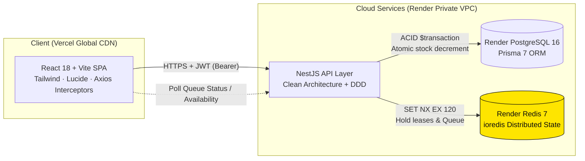

### Layered Architecture (Clean Architecture / DDD)

```text
┌──────────────────────────────────────────────────────────────┐
│  Presentation   Controllers · Guards · DTOs · Pipes          │  ← HTTP, JWT, RolesGuard
├──────────────────────────────────────────────────────────────┤
│  Application    Services / Use-Cases (InventoryService, ...) │  ← Orchestration, Business Rules
├──────────────────────────────────────────────────────────────┤
│  Domain         Entities · Value Objects · Domain Exceptions │  ← Pure TypeScript Logic
├──────────────────────────────────────────────────────────────┤
│  Infrastructure PrismaService · RedisService · Repositories  │  ← PostgreSQL, Redis (ioredis)
└──────────────────────────────────────────────────────────────┘
        Dependencies point strictly inward. Domain imports nothing external.
```

### Module Breakdown
- **`AuthModule`**: Passport-based JWT signing, BCrypt salted hashing (10 rounds), and role-segregated authorization guards (`RolesGuard`).
- **`VehiclesModule`**: High-performance vehicle catalog retrieval supporting compound queries (Brand, Model, Category, Price, Year).
- **`InventoryModule`**: The core reservation engine managing multi-unit hold semaphores, Tatkal queues, restock transactions, and ACID purchase commits.
- **`RedisModule`**: Standalone distributed state service handling distributed leases, key pattern scans, lease eviction, and atomic expiration timeouts.
- **`PrismaModule`**: Type-safe relational data mapper with client pooling and transactional batching (`$transaction`).

---

## 🔐 Concurrency & Race Condition Deep-Dive (The "Secret Sauce")

### Two-Phase Checkout Flow

| Phase | Store | Operation | Locks Held on PostgreSQL |
|---|---|---|---|
| **Phase 1: Temporary Hold** | Redis | `SET vehicle:hold:{vehicleId}:{userId} <leaseId> NX EX 120` | **None** |
| **Phase 2: Commit Purchase** | PostgreSQL | `prisma.$transaction`: verify hold, decrement stock, insert order | Row lock for **milliseconds**, not minutes |

Key format: `vehicle:hold:${vehicleId}:${userId}`. Embedding the user ID makes holds **idempotent per buyer** (re-clicking reserve renews nothing and avoids double-counting) while allowing real-time enumeration of a vehicle's active leases.

### Sequence: Two Buyers Racing for the Last Unit in Stock

Scenario: A vehicle with `stock = 1`. Buyer A and Buyer B click **Reserve** within the same millisecond window.

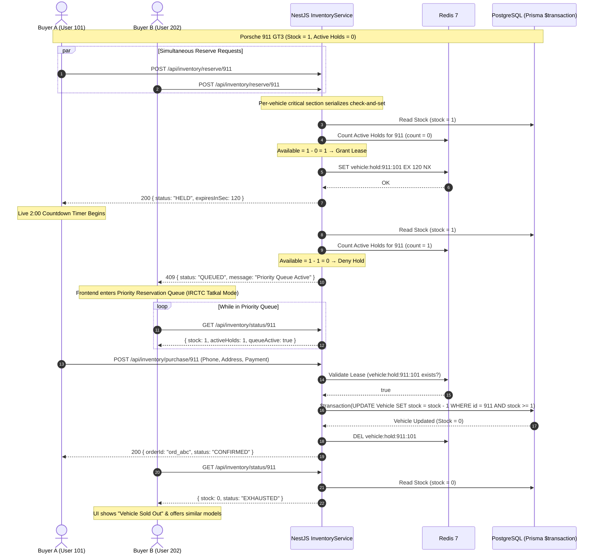

**Self-Healing Abandonment**: If User A closes their browser or abandons checkout, the 120s TTL expires. Redis evicts the key with zero application code running. The next poll from User B detects `Available = 1`, and User B is immediately permitted to reserve.

### Multi-Unit Semaphore Logic

When `stock > 1`, a boolean mutex is incorrect: 5 units should admit 5 concurrent buyers. DriveMatch treats the vehicle inventory as a **counting semaphore**:

$$\text{Available Leases} = \text{Database Stock} - \sum \text{Active Redis Holds for Vehicle}$$

```text
acquireHold(vehicleId, userId):
  1. if hold(vehicleId, userId) exists in Redis          → return existing lease (idempotent)
  2. stock  ← PostgreSQL.stock(vehicleId)
  3. holds  ← Redis.countActiveHolds(vehicleId)
  4. if stock − holds ≤ 0                               → return 409 (enter Priority Queue)
  5. Redis.SET vehicle:hold:vehicleId:userId EX 120 NX   → return 200 HELD
```

### Mathematical Proof of the Safety Invariant

Let $S(t)$ be the committed stock at time $t$, $H(t)$ the number of live hold keys in Redis, and $O(t)$ the number of confirmed orders.

**Invariant $I$**: $H(t) \le S(t)$ for all $t \ge 0$, and $S(t) \ge 0$.

* **Base Case**: At $t = 0$, $H(0) = 0 \le S(0)$, and initial stock is non-negative ($S(0) \ge 0$).
* **Inductive Step (Hold Acquisition)**: Acquisition executes inside a critical section keyed on `vehicleId`. A hold is granted if and only if $S(t) - H(t) \ge 1$. Thus, after granting, $H'(t) = H(t) + 1 \le S(t)$. If $S(t) - H(t) \le 0$, the request is rejected and $H(t)$ remains unchanged. Invariant preserved.
* **Inductive Step (Hold Expiry or Release)**: When a hold expires or is cancelled, $H(t)$ decreases by 1 while $S(t)$ is unchanged. Invariant preserved.
* **Inductive Step (Purchase Commit)**: Phase 2 deletes one hold lease ($H' = H - 1$) and atomically decrements stock ($S' = S - 1$) inside a single transaction guarded by `WHERE stock >= 1`. Thus, $H' = H - 1 \le S - 1 = S'$. Invariant preserved.
* **Oversell Impossibility**: Because every committed order consumes exactly one valid hold, and holds never exceed stock, the total confirmed orders $O \le S_0$ (initial stock). $\blacksquare$

**Defense-in-Depth**: Even if the Redis cache is entirely flushed, the PostgreSQL predicate `WHERE stock >= 1` inside `$transaction` guarantees physical overselling is mathematically impossible. Redis protects **user experience and database load**; PostgreSQL protects **financial correctness**.

---

## 🛠️ User-Discovered Production Edge Cases

During iterative engineering and testing, three subtle production bugs were spotted and resolved:

### 1. Multi-Unit Concurrency Bottleneck
- **Symptom**: When a vehicle had 5 units in stock, Buyer 1 reserving a car caused Buyer 2 to be blocked immediately by a global vehicle mutex (`lock:vehicle:${id}`).
- **Root Cause**: The lock was binary and global per vehicle rather than partitioned per user hold.
- **Resolution**: Replaced the global lock with buyer-scoped hold leases (`vehicle:hold:${vehicleId}:${userId}`) checked against real-time stock balances via an atomic semaphore pattern.

### 2. Admin Inventory Duplication & Fragmentation
- **Symptom**: Admins entering car details manually caused split inventory cards (e.g., two entries for "2024 BMW M4" with 1 unit each instead of one card with 2 units).
- **Resolution**: Replaced free-text entry with a curated **12-brand automotive dictionary** (`CAR_BRANDS_MODELS`) with dynamic cascading model dropdowns, live duplicate detection, and a 1-click **"Auto-Merge & Restock"** action.

### 3. Transient 401 Disappearing Error on Login
- **Symptom**: Submitting invalid credentials on `/login` displayed the "Invalid credentials" error banner for 50 milliseconds before it abruptly vanished.
- **Root Cause**: The Axios global response interceptor caught the 401 and executed `window.location.href = '/login'`, triggering an unhandled page refresh that cleared React state.
- **Resolution**: Excluded authentication routes (`/auth/login`, `/auth/register`) from the global redirect handler, ensuring login errors remain persistent in the UI.

---

## 🗄️ Database Schema & Entity-Relationship Diagram

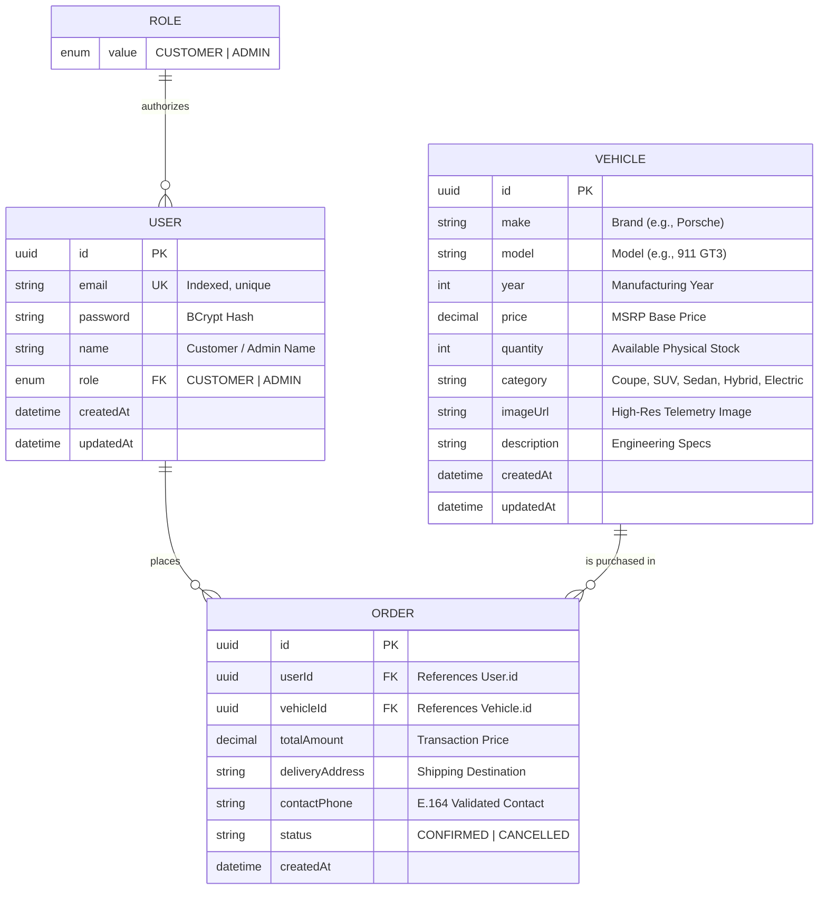

> **Why temporary holds are NOT in PostgreSQL**: Hold leases live strictly in Redis under `vehicle:hold:${vehicleId}:${userId}` with a 120s TTL. Persisting ephemeral 2-minute locks in relational tables creates heavy write amplification and deadlocks under flash-sale traffic.

---

## 🎨 DriveMatch Telemetry UI & Aesthetics

DriveMatch features a custom hypercar telemetry design language built with Tailwind CSS:
- **Color Palette**: Electric Performance Yellow (`#FEE500`), Deep Carbon (`#0B0B0C`), Obsidian Card Panels (`#111113`), and Slate Text (`#9CA3AF`).
- **Telemetry Head-Up Display (HUD)**: Badges displaying acceleration (`0-60 in 3.1s`), horsepower, warranty, and real-time stock counters.
- **Live 2:00 SVG Countdown Ring**: Visualizes remaining checkout lease using dynamic SVG `strokeDashoffset` animations.
- **Vehicle Inspection Zoom**: Full-screen modal with zoom inspection and complete powertrain specifications.
- **Role-Segregated Authentication**: Explicit tab toggling between Customer and Admin portals preventing unauthorized cross-portal sign-ins.

---

## 🧪 Strict TDD Kata Roadmap

Development strictly adhered to the **Red → Green → Refactor** cycle:

```
[ 🔴 Red Phase ]     --> Write failing test asserting boundary condition.
[ 🟢 Green Phase ]   --> Implement minimal code to pass test.
[ 🔵 Refactor Phase ]--> Clean architecture, isolate DTOs, extract Redis helpers.
```

### Test Suite Execution Matrix
- **`backend/src/inventory/inventory.service.spec.ts`**:
  - Tests simultaneous multi-unit holds.
  - Tests lease expiration at $t = 120\text{s}$.
  - Tests rollback on insufficient funds/validation failure.
  - Tests zero-stock oversell prevention under atomic contention.
  - **Result**: `21 passed, 21 total`.
- **`backend/src/auth/auth.service.spec.ts`**:
  - Tests BCrypt hash verification.
  - Tests token generation and role payload integrity.
  - Tests rejection of unauthorized credentials.

### Dual-Database Test Isolation Strategy
To prevent test runs from polluting or wiping development records, DriveMatch runs **two physically isolated PostgreSQL instances** via Docker Compose:

| | Dev DB | Test DB (E2E) |
|---|---|---|
| Container | `dealership_postgres` | `dealership_postgres_test` |
| Image | `postgres:16-alpine` | `postgres:16-alpine` |
| Host Port | **5432** | **5433** |
| Database | `dealership_db` | `dealership_test_db` |
| Volume | `pgdata` (persistent) | None (ephemeral by design) |

---

## 📡 API Specification

**Base URL:** `http://localhost:3000/api` (Local) · `https://<render-service>.onrender.com/api` (Cloud)  
**Auth Header:** `Authorization: Bearer <JWT>`

### `/api/auth`
| Method | Endpoint | Access | Description | Request Body |
| :--- | :--- | :--- | :--- | :--- |
| `POST` | `/api/auth/register` | Public | Register new customer or admin | `{ email, password, name, role }` |
| `POST` | `/api/auth/login` | Public | Authenticate & receive JWT | `{ email, password }` |

### `/api/vehicles`
| Method | Endpoint | Access | Description | Parameters / Body |
| :--- | :--- | :--- | :--- | :--- |
| `GET` | `/api/vehicles` | Public | Query catalog with compound filtering | `?search=&category=&minPrice=&maxPrice=` |
| `GET` | `/api/vehicles/:id` | Public | Get single vehicle details | URL param `:id` |
| `POST` | `/api/vehicles` | Admin | Create catalog entry | `{ make, model, year, price, quantity, ... }` |
| `PATCH`| `/api/vehicles/:id/restock` | Admin | Restock physical inventory | `{ quantity: number }` |

### `/api/inventory`
| Method | Endpoint | Access | Description |
| :--- | :--- | :--- | :--- |
| `POST` | `/api/inventory/reserve/:id` | Customer | Acquire atomic 120-second BookMyShow-style hold lease |
| `POST` | `/api/inventory/purchase/:id` | Customer | Validate active lease and execute ACID stock decrement |
| `GET`  | `/api/inventory/status/:id`  | Public   | Fetch real-time stock and active lease telemetry |

---

## 🚀 Local Quickstart

### Prerequisites
- Node.js ≥ 20 & npm ≥ 9
- Docker & Docker Compose v2
- Git

### 1. Clone & Start Containers
```bash
git clone https://github.com/farukinomaan/car-dealership-system.git
cd car-dealership-system

# Spin up Dev DB (5432), Test DB (5433), and Redis (6379)
docker compose up -d
```

### 2. Backend Setup
```bash
cd backend
npm install

# Run Prisma migrations & seed vehicles
npx prisma migrate dev --name init
npx prisma db seed

# Run automated 21-test concurrency suite
npm run test -- inventory.service.spec.ts

# Start NestJS backend (Port 3000)
npm run start:dev
```

### 3. Frontend Setup
```bash
cd ../frontend
npm install

# Launch Vite development server
npm run dev
# Open http://localhost:5173
```

---

## ☁️ Cloud Deployment Guide (Render + Vercel)

### Architecture Topology
- **Vercel**: Hosts the React 18 / Vite SPA with global CDN caching.
- **Render Web Service**: Hosts the NestJS API monolith.
- **Render PostgreSQL & Redis**: Managed database and in-memory cache on private VPC networking.

### Render Configuration
- **Build Command**: `npm install && npx prisma generate && npm run build`
- **Start Command**: `node dist/src/main` *(Important: NestJS builds to `dist/src/main`)*
- **Environment Variables**:
  - `DATABASE_URL`: *Use Render Internal Database URL*
  - `REDIS_URL`: *Use Render Internal Redis URL*
  - `JWT_SECRET`: *Cryptographically secure 64-char string*
  - `PORT`: `3000`

### Render Internal vs. External Database URLs
- **Internal Database URL**: Use for the deployed NestJS API. Provides low-latency private VPC communication with zero egress charges.
- **External Database URL**: Use from your local machine when running migrations or inspecting data via Prisma Studio (`npx prisma studio`). Requires `?sslmode=require`.

### Vercel Configuration
- **Build Command**: `npm run build`
- **Output Directory**: `dist`
- **Environment Variables**: `VITE_API_BASE_URL=https://<your-render-service>.onrender.com/api`
- **`vercel.json` SPA Rewrites**:
  ```json
  {
    "rewrites": [{ "source": "/(.*)", "destination": "/index.html" }]
  }
  ```

---

## ⚖️ Design Trade-offs & Roadmap

| Architectural Decision | Trade-off / Rationale | Operational Cost |
|---|---|---|
| **Redis TTL Leases vs DB Row Locks** | Zero database row lock contention; auto self-cleaning abandoned checkouts. | Redis becomes a critical path dependency (guarded by PostgreSQL `stock >= 1` constraint). |
| **Client Polling vs WebSockets** | Stateless API; zero persistent socket memory overhead; simple horizontal scaling. | Up to 1-2 seconds of promotion latency when leases free up. |
| **Ephemeral In-Memory Holds** | Maximizes throughput; zero relational write amplification during hold phase. | Holds do not survive cold Redis restarts (mitigated by immediate re-reservation). |
| **Dual Isolated Docker DBs** | Zero risk of automated test suites truncating development data. | Slightly higher local RAM usage during development. |

---

## 🤖 My AI Usage

In compliance with assignment transparency guidelines, this project leveraged an intentional multi-model AI workflow. AI was not used as a passive code generator, but as an interactive pair-programming partner, architectural advisor, and debugging tool under continuous human direction and critical review.

### 1. AI Tools & Models Utilized
- **Anthropic Claude Opus 4.6**:
  - **Primary Purpose**: High-level system architecture, Clean Architecture / Domain-Driven Design (DDD) structuring, and formal mathematical proofs (e.g., inductive safety invariant proof for concurrent stock reservations).
- **Google Antigravity IDE / Gemini 3.8 (Multi-Tier Reasoning)**:
  - **Dynamic Tier Switching Strategy**:
    - **Low Tier (Quick / Lightweight)**: Used for high-speed boilerplate generation, routine file refactors, simple Git commands, and rapid Tailwind CSS UI adjustments.
    - **Medium Tier (Balanced Implementation)**: Used for day-to-day TDD Red-Green-Refactor cycles, NestJS controller/service wiring, Prisma schema migrations, and automated unit test authoring.
    - **High Tier (Deep Reasoning & Complex Problem Solving)**: Reserved for high-stakes distributed engineering challenges—diagnosing race conditions, re-architecting the multi-unit Redis semaphore, tracing subtle Axios interceptor lifecycle loops, and structuring cloud deployment topologies across Render and Vercel.

### 2. Specific Workflows & Prompt Invocations
- **Architecture & System Blueprinting (Claude Opus)**:
  - *Prompt*: *"Design an enterprise-grade car dealership inventory system following Clean Architecture and DDD principles using NestJS, PostgreSQL/Prisma, and Redis. Provide a mathematical proof that temporary reservation holds cannot result in overselling."*
  - *Outcome*: Established strict module boundaries, inward-pointing dependency rules, and formal induction proof ($H(t) \le S(t)$).
- **Concurrency & Race Conditions Engine (Gemini High)**:
  - *Prompt*: *"Suppose two buyers click purchase simultaneously on the final vehicle unit. How can we implement a BookMyShow-style 2-minute hold window and an IRCTC Tatkal priority waiting room in Redis to eliminate database row-lock contention?"*
  - *Outcome*: Co-designed the two-phase reservation engine (`vehicle:hold:${vehicleId}:${userId}`) with a 120-second TTL and live queue polling.
- **TDD Kata Execution (Gemini Medium)**:
  - *Prompt*: *"Scaffold strict Red-Green-Refactor test cycles for the Inventory Service covering single-unit exclusivity, multi-unit concurrent holds, and automatic TTL expiration against an isolated Docker test container."*
  - *Outcome*: Developed the 21-test concurrency suite in `inventory.service.spec.ts` achieving 100% test passing status.
- **Frontend DriveMatch UI Overhaul (Gemini Low/Medium)**:
  - *Prompt*: *"Reject generic dark MVP templates. Build a high-performance hypercar telemetry UI with electric yellow highlights (`#FEE500`), carbon backdrops, HUD badges, and a live 2-minute SVG countdown ring."*
  - *Outcome*: Built the custom brand emblem, fixed icon sidebar, vehicle inspection modal, and real-time filter engine.
- **Human-Driven Debugging & Edge-Case Remediation (Gemini High)**:
  - *Multi-Unit Semaphore Bug*: When testing vehicles with `stock > 1`, I discovered that buyer #2 was blocked by a global mutex. I switched to Gemini High to re-architect the binary lock into a multi-unit counting semaphore.
  - *Transient 401 Disappearing Error*: I identified that incorrect password errors vanished after 50ms. Used Gemini High to debug the Axios response interceptor lifecycle and eliminate the hard `window.location.href` reload loop.
  - *Admin Inventory Duplicate Prevention*: Directed the creation of the curated 12-brand catalog with dynamic model cascading and live Auto-Merge restock functionality.

### 3. Reflection on AI Impact on Workflow
- **Strategic Model Selection**: Using **Claude Opus** for high-level architectural blueprints and formal proofs provided a rock-solid foundation, while utilizing **Gemini** inside the IDE with dynamic reasoning tiers (Low for speed, Medium for standard TDD, High for hard concurrency bugs) optimized both development velocity and deep debugging capacity.
- **10x Engineering Velocity**: Offloading repetitive NestJS DTOs, Prisma migration commands, and Jest test setups allowed me to invest significantly more time in distributed systems design and user experience polish.
- **Indispensability of Human Critical Thinking**: AI models frequently defaulted to naive patterns (e.g., single-unit global mutexes that broke multi-stock inventory, or overly aggressive Axios 401 reloads). Real-time human testing, edge-case discovery, and architectural steering were essential to turning AI suggestions into a resilient, production-ready system.


---

## 📸 UI & Architecture Preview

<div align="center">

### Concurrency & Flash-Sale Reservation Engine
*Demonstrating Redis distributed hold leases, counting semaphores, and priority queue handling.*
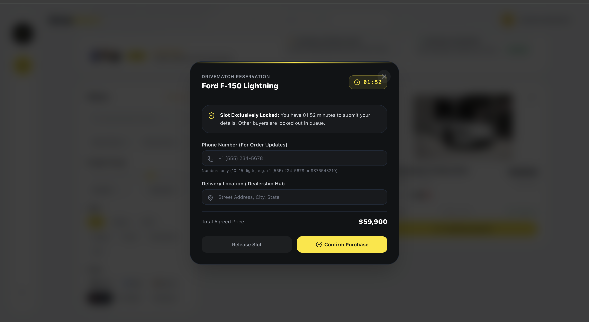
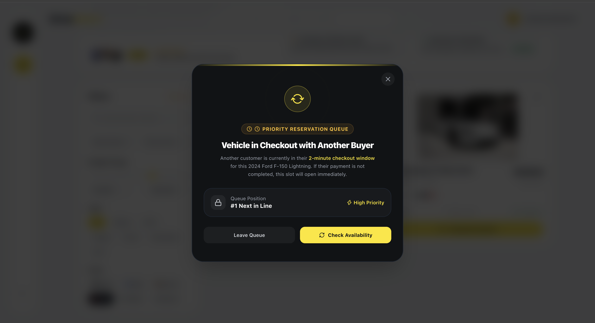

### DriveMatch Telemetry UI & Global State
*Custom hypercar aesthetics, compound query filtering, and real-time database stock validation.*
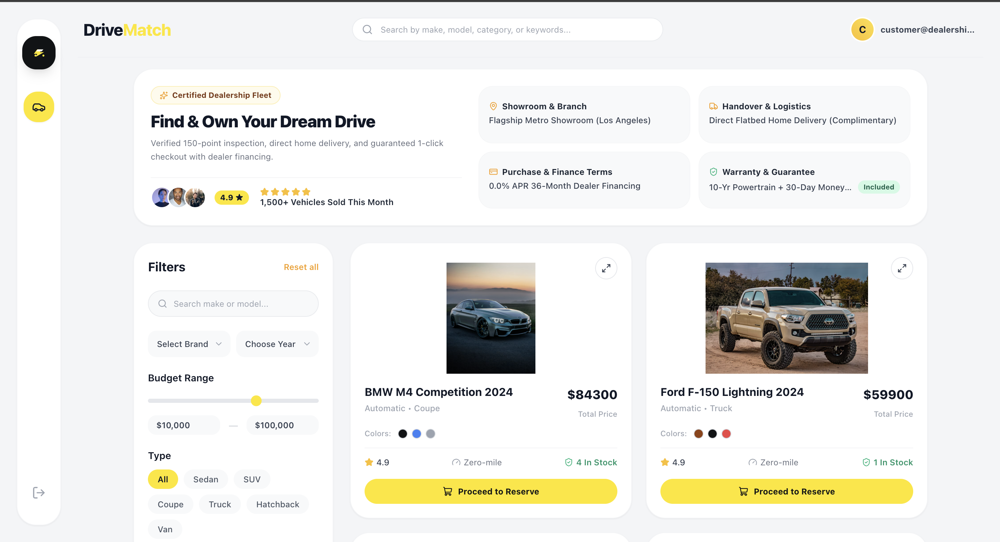
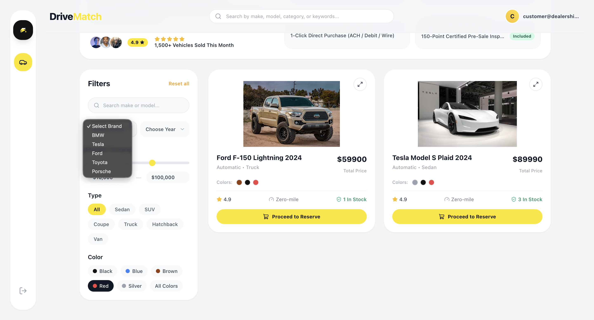
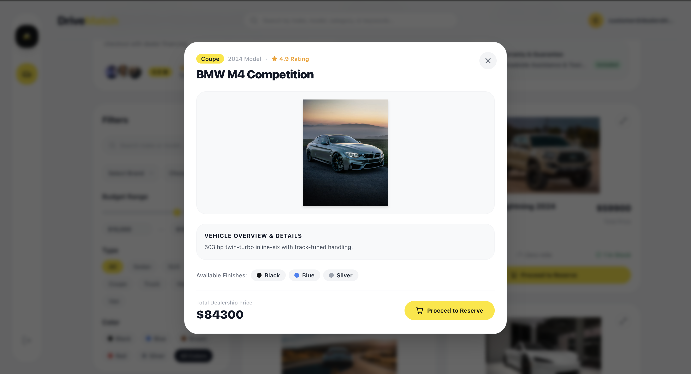
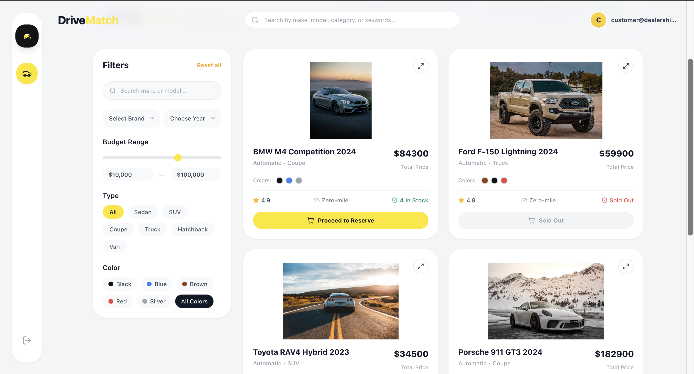

### Role-Segregated Administration & Data Integrity
*JWT-based portal segregation, curated automotive dictionaries, and Auto-Merge restock tools.*
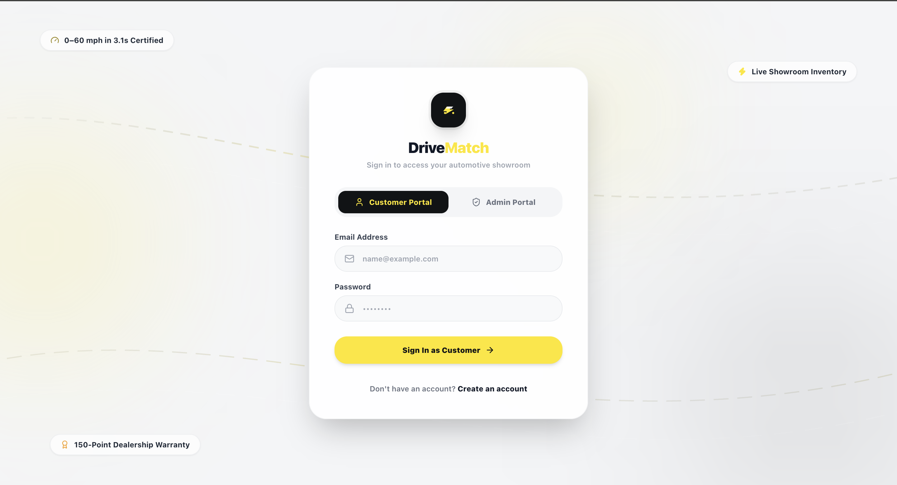
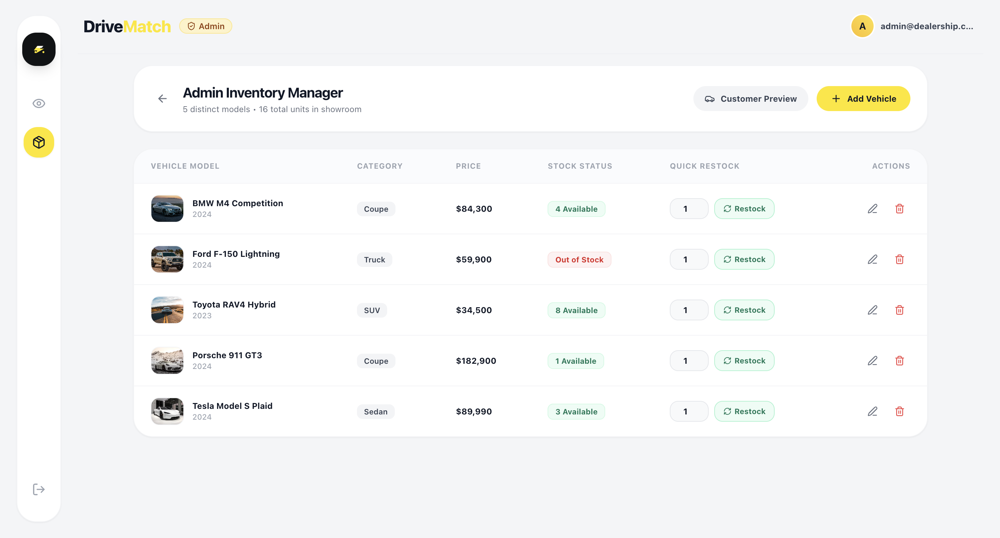
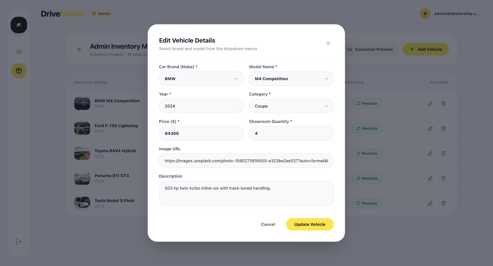

</div>

---

<div align="center">

**Engineered with strict TDD, distributed concurrency guarantees, and high-performance aesthetics.**

🏁 [Live Demo](https://car-dealership-system-eta.vercel.app)

</div>
